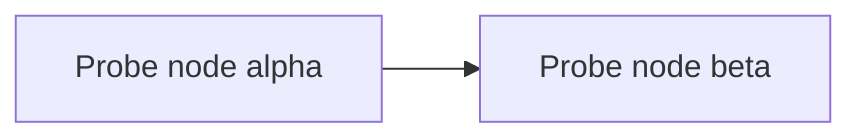

# Render probe

A formula that KaTeX renders while the talk is built:

$$
\frac{probe_{numerator}}{probe_{denominator}}
$$

---

# A diagram

Mermaid renders in the browser, so only the exported PDF shows its labels.

